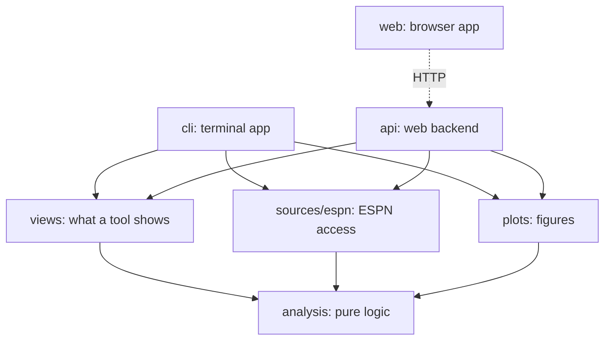

# Architecture

fantasyNHL reads a league from ESPN, computes on it, and shows the result
in a terminal app and in a local web app. The code is in layers, and
imports point one way.

## Layers



| Layer | Role | Documented in |
| --- | --- | --- |
| `analysis` | Computes. Pure functions of records and tables. | [analysis.md](../src/fantasy_nhl/analysis/analysis.md) |
| `sources/espn` | Fetches from ESPN and returns plain data. | [espn.md](../src/fantasy_nhl/sources/espn/espn.md) |
| `views` | Builds what a tool shows: tables, notes, text, figures. | [views.md](../src/fantasy_nhl/views/views.md) |
| `plots.py` | Draws the figures a view describes. | below |
| `cli` | Terminal front end: prompts, fetches, renders. | [cli.md](../src/fantasy_nhl/cli/cli.md) |
| `api` | Web backend: the views as JSON, figures as PNG. | [api.md](../src/fantasy_nhl/api/api.md) |
| `web` | Browser front end rendering what `api` serves. | [web.md](../web/web.md) |
| `tests` | The offline test suite. | [tests.md](../tests/tests.md) |

Why the layers are cut this way:

- `analysis` knows nothing of ESPN, of views or of a front end, so it can
  be tested without a network and reused for other data sources.
- `views` build on `analysis` and neither fetch nor render, so the two
  front ends cannot drift apart: they show the same view.
- `cli` and `api` fetch, call a builder and render. They know nothing of
  each other, so the web dependencies stay optional.

The import rules are checked by
[tests/test_layering.py](../tests/test_layering.py).

## How a tool runs

1. The front end collects the choices: prompts in the terminal, query
   parameters in the web app.
2. It fetches what the tool needs through `sources/espn` (the terminal
   once per run, the backend through its session cache).
3. It calls the builder in `views` with the league, the fetched data and
   the choices, and gets a `View`.
4. It renders the view: the terminal prints tables and saves figures to
   `plots/`; the backend serializes it to JSON, and the browser renders
   that.

## Top-level modules

- [config.py](../src/fantasy_nhl/config.py): `LeagueConfig`, `Category`
  and `ScheduleCalibration`. `load_config` merges `config.yaml` with the
  credentials of `secrets.yaml` (keyed by league name) and the stored
  calibrations of `calibration.yaml`; `save_calibration` writes the
  latter. The paths are relative to the working directory, which is why
  both apps are started from the repository root.
- [plots.py](../src/fantasy_nhl/plots.py): the matplotlib figures. A
  `FigureBlock` of kind `x` is drawn by `x_figure(**inputs)`, which
  returns the figure; `save_figure` and `render_png` write it. It may
  import `analysis` only, and the front ends import it lazily because
  matplotlib is slow to load.

## Repository

```
README.md                    # install, configure, run
AGENTS.md                    # entry point for coding agents
config.yaml                  # leagues and scoring categories (committed)
secrets.example.yaml         # template for secrets.yaml (ESPN cookies, gitignored)
calibration.yaml             # stored schedule-scoring calibrations (written by the tool)
pyproject.toml               # package metadata, dependencies, entry points
docs/                        # general and cross-module documentation
src/fantasy_nhl/
  config.py, plots.py        # see above
  analysis/                  # pure logic
  sources/espn/              # ESPN access
  views/                     # what each tool shows
  cli/                       # the terminal front end
  api/                       # the web backend
web/                         # the browser front end (Vite, React, TypeScript)
tests/                       # pytest suite, synthetic league, golden transcripts
plots/                       # figures saved by the terminal app (gitignored)
```

Each folder's own doc lists its files.

